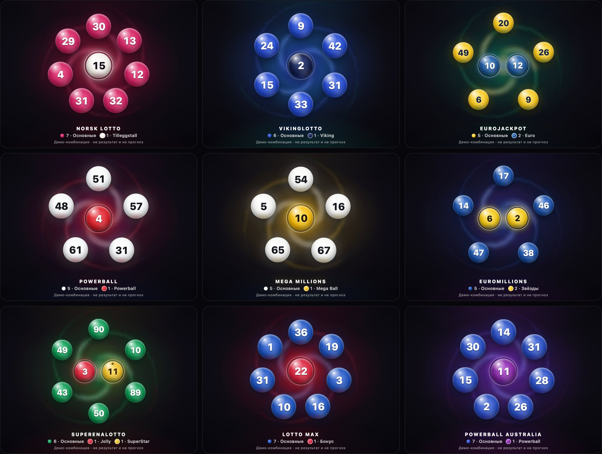

# Preloader Demo — Lottery Whirl

**Демоверсия:** <https://redsprut.github.io/lottery-whirl-demo/>

Самостоятельный демонстрационный стенд анимации **Lottery Whirl** — стартового прелоадера приложения
Lotto Simulator. Все шары случайной комбинации выбранной лотереи вылетают вихрем из светящегося ядра,
складываются в читаемую композицию и растворяются. Стенд нужен для просмотра, сравнения и экспериментов
с новыми анимациями и дизайном.

Здесь только статические файлы (HTML, CSS, JS-модули, данные о правилах и цветах лотерей). Ни сборки,
ни зависимостей, ни серверной части, ни внешних запросов. Сайт публикуется GitHub Pages прямо из ветки
`main`: каждый `git push` в `main` обновляет демоверсию.



## Возможности

* 9 лотерей: Norsk Lotto, Vikinglotto, Eurojackpot, Powerball, Mega Millions, EuroMillions,
  SuperEnalotto (с SuperStar), Lotto Max, Powerball Australia. Клавиши 1–9.
* Режимы **«Одна»** и **«Все 9»** (сетка 3×3 для прямого сравнения; клавиша G).
* **«Повторить»** (R) — та же комбинация, новые траектории. **«Случайная комбинация»** (пробел) — новая комбинация.
* Скорость **0.5× / 1× / 1.5× / 2×**.
* Композиция **«Кольцо»** (основные по кругу, дополнительные — в светящемся ядре) или **«Линия»**.
* **«Зафиксировать»** оставляет композицию на экране (для скриншотов). Есть **«Автоповтор»**.
  **«Меньше движения»** — вариант для `prefers-reduced-motion` (системная настройка учитывается и без него).
* Адаптивная вёрстка для телефонов, планшетов и компьютеров.
* Параметры в адресе: `?game=vikinglotto&speed=1&layout=ring&hold=1&view=grid&auto=1&reduced=1`.

## Локальный запуск

Нужен Node.js 18 или новее; зависимости не требуются.

```bash
node serve.mjs
```

Откройте <http://localhost:5317/>. Чтобы открыть стенд с телефона в той же сети Wi‑Fi, запустите
`node serve.mjs --lan`. Другой порт задаётся так: `--port=6000`.

## Файлы

| Файл | Роль |
|---|---|
| `whirl-engine.js`, `whirl.css` | Движок анимации (`createWhirl(host).play(spec)`) |
| `combo.js` | Генератор комбинаций по правилам лотерей |
| `themes.js` | Палитра лотерей |
| `index.html`, `stand.js`, `stand.css` | Интерфейс стенда |
| `vendor/registry.js` | Правила 9 лотерей (копия реестра барабана приложения) |
| `vendor/palette.json` | Цвета шаров и шапки каждой лотереи (токены из приложения) |
| `vendor/pool-labels.js` | Названия пулов шаров на 17 языках |
| `tools/sync-from-app.mjs` | Обновляет `vendor/` из локальной копии приложения |
| `serve.mjs` | Локальный сервер для разработки |
| `test.mjs` | Проверки и скриншоты |
| `screenshots/` | Скриншоты всех девяти лотерей |

## Независимость от приложения

У стенда **собственная копия движка**. Изменения в приложении его не ломают, а эксперименты здесь не
затрагивают приложение. Утверждённый вариант встроен в приложение отдельно, как `lottery-whirl.js`.
Новые идеи удобно сначала пробовать здесь, а потом переносить туда.

Общие с приложением только данные, и они лежат копией в `vendor/`. Если в приложении изменились правила
или цвета лотерей, обновите копию:

```bash
node tools/sync-from-app.mjs /path/to/loto-simulator
```

Если `vendor/palette.json` не загрузится, стенд возьмёт запасную палитру из реестра и напишет об этом
внизу страницы.

## Данные

* Правила лотерей сверяются с официальными операторами. Для SuperEnalotto добавлен SuperStar
  (отдельный барабан 1–90).
* Если дополнительный шар тянется из того же барабана (Tilleggstall, Jolly, Lotto Max Bonus), он берётся
  из оставшихся шаров и не совпадает с основными. Если барабан отдельный (Viking, Euro, Powerball,
  Mega Ball, Lucky Stars, Powerball AU), шар тянется независимо и может совпасть с основным числом.
* Случайность — `crypto.getRandomValues`, без перекоса по модулю. Барабаны создаются заново на каждый
  запуск, номера идут в порядке выпадения, без сортировки. Комбинации — только демонстрация, а не
  результаты тиражей и не прогнозы.

## Проверки

```bash
npm i --no-save playwright && npx playwright install chromium webkit
node test.mjs
BASE_URL=https://redsprut.github.io/lottery-whirl-demo/ node test.mjs   # проверить опубликованный сайт
```

По умолчанию тесты идут в Chromium и WebKit. `BROWSERS=chromium,webkit,firefox` добавляет Firefox,
`SHOTS=1` обновляет `screenshots/`.

Что проверяется:

* 40 000 комбинаций на каждую игру;
* 9 лотерей × 5 экранов × 2 композиции, плюс сетка 3×3;
* быстрые переключения и повторные генерации;
* что DOM, анимации и rAF не накапливаются;
* reduced motion;
* ошибки JS и частота кадров.
